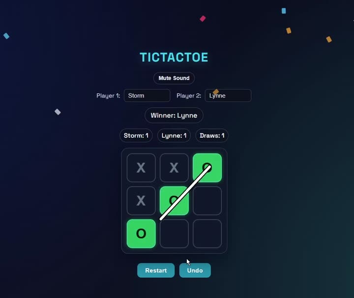

# TicTacToe

A two-player Tic Tac Toe game I built in React. You put in both players' names, take turns on the same screen, and it keeps score of wins and draws across rounds. When someone wins, a line gets drawn through the winning three and confetti goes off.



## What it does

- Type in a name for each player, and the game uses them everywhere (turns, scores, the winner message)
- Shows whose turn it is, and highlights the winning three with a line through them
- Keeps a running scoreboard of wins for each player and draws
- **Undo** takes back the last move, **Restart** clears the board but keeps the scores
- Little pop-up messages for wins and draws, and confetti when someone wins
- Sound effects for moves, wins and draws, with a mute button. The sounds are generated in the browser with the Web Audio API, so there are no audio files

## Tech

- **React** (with `useReducer` for the game state)
- **Webpack + Babel**, set up by hand rather than with Create React App or Vite, so I could see how a React build actually gets put together
- **CSS** for the styling and animations
- Deployed on **Netlify**

## What's in here

```
TicTacToe/
├── src/
│   ├── App.js          the whole game: board, scoring, undo, sounds, confetti
│   ├── App.css         styling and animations
│   └── index.js        mounts the app
├── public/
│   ├── index.html      the page the app gets injected into
│   └── _redirects      tells Netlify to always serve index.html (see below)
├── webpack.config.js   how the app gets bundled
└── .babelrc            lets webpack understand JSX and modern JavaScript
```

## Running it yourself

```bash
npm install
npm start          # opens it in the browser with live reloading
```

To make a production build (this is what goes on Netlify):

```bash
npm run build      # outputs to dist/
```

## How the game logic works

All the game state (the board, whose turn it is, the scores, the move history and the player names) lives in one `useReducer`. Every click sends a move to the reducer, which checks it's allowed, places the X or O, then checks all eight possible winning lines. If there's a winner it records which three squares won so the line can be drawn through them, and if the board is full with no winner it's a draw.

Undo works because every move saves the previous board into a history list, so undoing just pops the last one back off.

## Challenges I ran into (and how I fixed them)

**404 errors on Netlify.** It worked fine on my machine, but the deployed version kept giving me a 404 page. Netlify didn't know that every route should load the React app, so I added a `_redirects` file that sends everything to `index.html`. Then it still didn't work, because webpack wasn't copying that file into the `dist` folder that actually gets deployed. I added `copy-webpack-plugin` to the webpack config so every build copies `_redirects` into `dist` automatically.

**Making it feel good to play.** The first version worked, but it felt flat. I went back and added the turn badge, the line through the winning squares, the pop-up messages, the sounds and the confetti, and tweaked the contrast so the board is easier to read.

## What I'd improve next

- A single-player mode against the computer (probably minimax, so it can't be beaten)
- Saving the scores so they survive a page refresh
